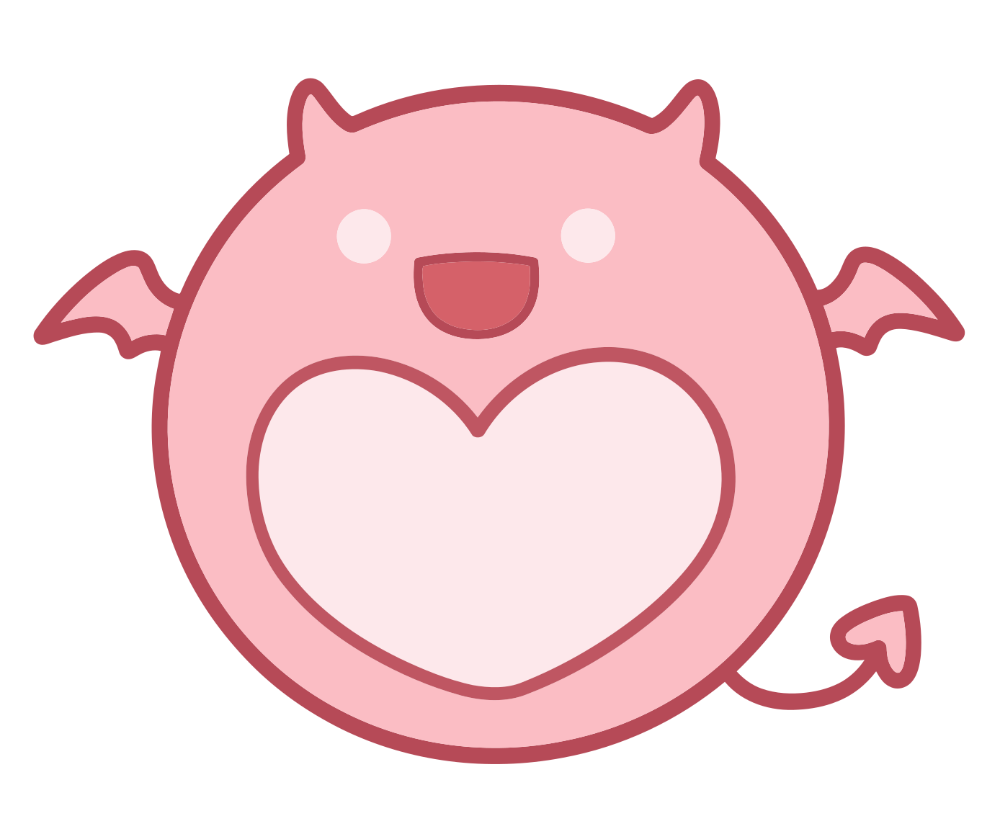

<div align="center">



# 子智能体模型切换

[](https://www.npmjs.com/package/dsh-subagent-model-sync)
[](LICENSE)
[](https://github.com/deepseek-ai/deepseek-harness)

DSH 插件 ｜ `dsh-subagent-model-sync` ｜ v0.0.1<br>
图标由「一只阿叽的储备粮」提供

</div>

---

给子智能体、团队队友和嵌套后代一个**可手动切换的模型入口**。

DSH 里子智能体的模型路由在**创建那一刻**就写进了它自己的会话记录，之后主会话怎么切模型都影响不到它。
本插件把切换权交给用户：在子代理的输入框右下角直接选模型、选思考强度，也可以让主会话一键同步全部子代理。

**它最重要的用途不是"换着玩"，而是把卡死的子代理救回来**——详见下一节。

---

## 为什么需要它

子代理完成任务后，DSH 会通知并唤醒父会话，主对话才能继续。
但如果子代理是因为**模型侧失败**停下的——渠道下线、额度耗尽、鉴权失效——它**根本不会产生完成通知**，
于是父会话收不到唤醒，**整轮对话就卡死在那里**。

而额度类错误（`QUOTA` / `ACCOUNT_QUOTA`）**不在**官方的自动重试集合里，属于终态，不会自己恢复。

此时你能做的只有：给它换一个还能用的模型。而官方**有意不开放**这个入口——
子代理会话的模型控件被主动关闭，`/model` 不可用，后台接口也会拒绝。

本插件就是补上这个缺口：

> **换掉子代理的模型 = 把唤醒链路接回去。**

---

## 两个能力

### 一、手动切换（主要能力）

在**任意子代理 / 团队队友**的会话里，输入框右下角会出现本插件的控件：

- 显示该子代理**当前真实生效的路由**（`提供方 / 模型`）与来源标识；
- 点开可按提供方分组浏览、搜索并选择任意模型，**不受子代理白名单限制**；
- 面板底部固定一条「思考强度」，档位随所选模型从模型目录实时读取；模型不支持时置灰并注明；
- 选完不需要重开会话，**下一次模型请求就会用新模型**，上下文完整保留。

来源标识有三种：

| 标识 | 含义 |
|---|---|
| 📌 手动指定 | 你为这个子代理单独指定的模型 |
| ↳ 跟随中 | 主会话开启了同步，它正在跟随主会话 |
| 无标记 | 未做任何改动，走官方原生路由 |

### 二、同步子代理（辅助能力）

主会话输入框右下角另有一枚小开关。打开后，**该会话下所有子代理、团队队友及其后代都会跟随主会话的当前模型**。

#### 触发机制

理解下面三点，就不会对行为感到意外：

1. **勾选本身不改变任何东西。** 开关只写入一个偏好标记，不改路由、不动历史、不发任何消息给子代理。
2. **真正的切换发生在"下一次模型请求"那一刻。** 插件在每次模型请求前重新计算一次路由。所以：
   - 子代理**空闲**时勾选，什么都不会发生，直到它下次被唤醒（发消息、或被父会话再次委派）；
   - 子代理**正在运行**时勾选，当前这一次调用不受影响，**下一个步骤**就会用新模型。
3. **没有请求就没有改写。** 空闲的子代理不会自己醒来——这是设计，不是缺陷。

#### 取消勾选之后

- 子代理**不会回退到之前的旧模型**，而是停在它当前所在的模型（也就是官方原生的"最后一次请求"）。
- 原因很简单：那次被同步改写的请求已经真实发生了，并写进了会话日志。撤销开关不该让历史倒退。
- 如果某个子代理的单独指定在同步期间**被真正改写覆盖过**，该指定即失效；没有覆盖过的则原样保留。
- 因此：**来回勾选但一次消息都不发，等于什么都没做**，所有单独指定都不会丢。

#### 同步与单独指定谁优先

```
1（最高）  主会话开启了同步        ← 一票决定，压过单独指定
2          子代理页面手动切换      ← 同步关闭时生效
3          AI 委派时显式指定的路由
4（最低）  官方默认继承
```

同步开启期间，子代理面板会整体置灰并提示「需先关闭同步」——避免你设置了一个立刻会被覆盖的值。
主会话的开关面板会提前告诉你「有 N 个子代理使用单独模型，开启同步后它们在下次请求时会被覆盖」。

---

## 兼容性

| DSH 版本 | 状态 |
|---|---|
| `0.2.1-rc.3` | ✅ 已在此版本上开发并通过全部实测 |
| 更低版本 | ❌ 不支持（`engines.dsh` 会阻止安装） |
| 更高版本 | ⚠️ 未验证。版本范围写作 `>=0.2.1-rc.3`，可以安装，但请先看 [Releases](https://github.com/123123liang/dsh-subagent-model-sync/releases) 的兼容性说明 |

**Node.js ≥ 22。**

本插件依赖 DSH 的三个内部接口。**DSH 升级后如果它们变了，插件可能失效**：

| 依赖的接口 | 用途 |
|---|---|
| `agent/request` 事件（waterfall） | 在请求发出前改写路由，这是核心机制 |
| `sessionProjections.stateOf(session, 'modelSelection')` | 读取主会话"下一次请求将要用的路由" |
| `session.requestHeader()` | 读取会话最近一次真实请求的路由 |

仓库里带了一个兼容性自检脚本，能在升级后快速判断是否还兼容：

```bash
node tools/probe-resolver.mjs <某个会话日志文件>.zstd
```

它会用**真实日志**跑一遍生产用的解析函数。输出正常即接口未变；报错则说明上游改了，需要适配。
发新版前建议也跑一次。

---

## 安装

```bash
# 从 npm 安装
pnpm add dsh-subagent-model-sync
```

或在 profile 的 `package.json` 里用本地路径：

```jsonc
{
  "dependencies": {
    "dsh-subagent-model-sync": "link:<插件目录的绝对路径>"
  },
  "dsh": { "profile": { "bundles": ["dsh-subagent-model-sync"] } }
}
```

然后重启 DSH。前端 bundle 按文件元数据算版本，**刷新页面拿不到新代码，必须重启**。

> 本地路径请用 `link:`（包管理器创建符号链接）；**不要手工建立 Windows 目录联接（junction）**，
> 那会让本插件的浏览器半永远进不了启动图。

本插件同时包含 Host 半与浏览器半：Host 半负责改写路由并提供本地接口，浏览器半负责界面。
偏好只写给本机，接口只服务环回请求。

---

## 我们验证过什么

以下行为都用**真实请求**跑过，并逐条核对过会话日志里的 `request/header`（不是"界面上看着对"）：

| 能力 | 验证方式 |
|---|---|
| 手动切换模型后，被暂停的子代理**恢复时使用新模型** | 日志新增一条 `resume` 记录，路由为新选的模型 |
| 换模型时**自动丢弃**旧的思考强度档位 | 新记录中不带旧档位；再次手动选档后恢复 |
| 选择思考强度**真的写进请求** | 偏好文件与请求头同时出现该档位 |
| 主会话开启同步后，子代理**跟随主会话模型** | 子代理从原有路由切换到主会话路由（跨提供方） |
| 同步**压过**此前的单独指定 | 单独指定过的子代理在同步开启后被改写 |
| **被覆盖的单独指定会失效**，且切换只在请求发生时生效 | 唤醒一次后该子代理的单独指定消失；未发请求时保持不变 |
| **取消同步不回退** | 再唤醒一次后仍停在当时路由，未回到旧模型 |
| 不伪造会话事件 | 全程 `model/selection` 事件数保持为 0，路由只由官方 `request/header` 记录 |
| 无请求则无改写 | 只停止、不唤醒的子代理，日志条数不变 |
| 界面状态正确 | 同步开启时子代理面板显示的是**真实会跑的路由**，不是已失效的单独指定 |

自动化测试共 **41 条**：路由决策、偏好读写、真实 React 渲染、请求钩子与清理安全阀。

```bash
npm test        # 或 node --test
```

---

## 我们可能没做好的地方

诚实列出，避免误导：

| 项 | 说明 |
|---|---|
| 嵌套子代理（孙代理） | 逻辑上支持并有两遍扫描与环保护，但**没有在真实环境跑过**——本机的委派工具只产生一层子代理 |
| 一次性子代理（`one-shot`） | 官方会接管整个输入框并显示"一次性任务不支持后续消息"，因此本插件不渲染。**未做适配**；本机的委派工具只产生可继续的子代理，该场景实际遇不到 |
| 父会话未加载时的子代理页 | 官方会整块替换输入框为只读提示，本插件控件随之消失。打开一次父会话即恢复 |
| 远程访问 | 通过非本机地址打开页面时，控件仍会显示但点击无效（接口只服务环回请求）。**未做前端隐藏** |
| 切换的兼容性 | 新模型可能不支持图片、长上下文或工具调用。插件**只提示、不阻止**，请自行判断 |
| 子代理不知道自己换过模型 | 不伪造"模型已切换"提示，其对话历史里不会出现这类说明（有意如此，保持日志真实） |
| 团队面板的模型列 | DSH 团队面板不显示成员模型，这是上游的已知限制，与本插件无关 |
| 思考强度档位 | 不同提供方对档位的命名不一致，界面显示的是适配器给出的名字 |

### 与其它插件的关系

若同时使用其它"让子代理跟随父会话"的插件，两者都会改写子代理路由。本插件固定注册在最外层，
会**确定性地压过**对方的改写。建议只保留一个，避免难以排查的相互干扰。

---

## 免责声明

- **切换错模型导致的费用与本插件无关。** 模型、渠道、额度都由你自己选择并承担；
  选到更贵或计费异常的模型而产生的扣费，作者不负责。
- **本插件由 LLM 辅助生成，代码 100% 由 LLM 编写。** 已经过真实环境验证与自动化测试，
  但请自行评估风险；关键环境建议先小范围试用。
- 本项目不修改 DSH 官方代码，不伪造会话事件，卸载后不留痕迹。

---

## 卸载

从 profile 的 `bundles` 与依赖中移除，重启即可。
偏好文件位于 DSH 数据目录下的 `storages` 子目录中，可一并删除，也可保留（重装后仍会读回）。

